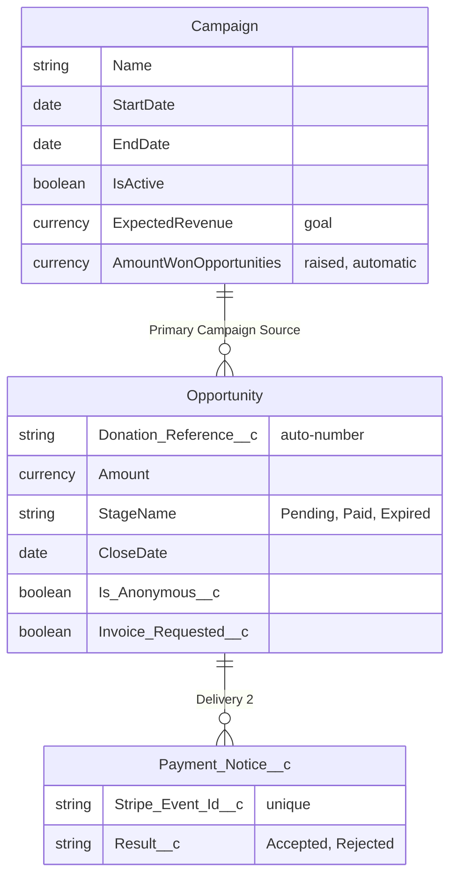

# Architecture

We build the portal with a **hybrid approach**: configuration and Flows for most of the solution, and code only where it adds something the declarative tools don't do well. The data model **reuses Salesforce's standard Campaign and Opportunity objects**, the usual way to model fundraising in Salesforce, and adds custom objects only where nothing standard fits.

## Approach

| Piece | Technology | Why |
|---|---|---|
| Data | Standard **Campaign** and **Opportunity** plus a few custom fields | Reuse avoids duplicating what Salesforce already has: dates, status, amounts and the campaign's raised total. |
| Public site | **Experience Cloud** site (Build Your Own template) with a guest user | Salesforce's native way to publish a site with no login. |
| Campaign pages and donor recognition | **LWC** with a read-only Apex controller | Lets us show images and a progress bar, and exposes only public fields to the guest. |
| Donation form | **LWC** | It must send the donor to Stripe's page, which a Screen Flow can't do without an extra component. It shows the conditional fields, the validation and the amount confirmation. |
| Start the payment | **Apex** (`DonationCheckoutService.startCheckout`) called from the LWC | Creates the Stripe Checkout Session and then the donation in one controlled step, and returns Stripe's URL. Stripe expects form-encoded requests, which Apex handles easily. |
| Payment confirmation (Delivery 1) | Apex that checks the session with Stripe when the donor returns, plus a **scheduled Apex** job (`PendingDonationCheck`, every 15 minutes) for pending and expired donations, scheduled by the integration user that holds the payment permission. Not a schedule-triggered flow: it runs as Automated Process, which can't get that permission set | The status always comes from Stripe, never from a person. |
| Receipt and simulated invoice | **Record-triggered Flow** with email templates in Spanish | No code needed. |
| Staff app | **Lightning App**, list views, page layouts and **permission sets** | Configuration only. |
| Webhook (Delivery 2) | **Apex REST** exposed through the site | The only option to receive Stripe's notices and verify their signature. |
| Stripe credentials | **Named Credential + External Credential** | The key never appears in code or metadata (M3). |

## Data model

### Campaign (standard): campaigns

| Need | Field | Standard or custom | Story |
|---|---|---|---|
| Name | `Name` | Standard | US-08 |
| Description | `Description` | Standard | US-01 |
| Start and end date | `StartDate`, `EndDate` | Standard | US-08 |
| Active or paused | `IsActive` | Standard | US-08 |
| Goal | `ExpectedRevenue`, relabeled "Goal" | Standard | US-08 |
| Amount raised | `AmountWonOpportunities`: Salesforce sums the paid donations automatically | Standard | US-01 AC2 |
| Image | `Image_URL__c` (URL) | Custom | US-01 |
| What the money is for | `Purpose__c` (text) | Custom | US-01 |
| Progress % | `Progress__c`: formula, raised ÷ goal | Custom | US-01 |
| Accepting donations now | `Accepts_Donations__c`: formula, `IsActive` and today within the dates | Custom | US-08 AC7 |

Start date, end date, goal, description, image and purpose are required (`Campaign_Required_Fields`). The always-open general donation campaign (US-08 AC8) uses a far end date, such as 2099-12-31. Campaign managers need the "Marketing User" checkbox on their user to edit campaigns.

### Opportunity (standard): donations

Donations use their own record type "Donation", with a sales process whose stages are the donation statuses:

| Stage | Type | Meaning |
|---|---|---|
| `Pending` | Open | The form was submitted and we are waiting for Stripe. Not public and not counted. |
| `Paid` | Closed / Won | Stripe confirmed the payment. It counts in the campaign's raised amount. |
| `Expired` | Closed / Lost | The Stripe session expired without a payment. |

| Need | Field | Standard or custom | Story |
|---|---|---|---|
| Campaign | `CampaignId` (Primary Campaign Source) | Standard | US-03 |
| Amount | `Amount` | Standard | US-03, US-13 |
| Status | `StageName` | Standard | US-03 |
| Payment date | `CloseDate` | Standard | US-14 |
| Record name | `Name`, set automatically, for example "DON-0001 · Campaign" | Standard | — |
| Our reference | `Donation_Reference__c`: `DON-` plus 8 random characters, set by Apex before calling Stripe (no callout is allowed after DML in one transaction) and sent as `client_reference_id` | Custom | US-03 AC2 |
| Anonymous | `Is_Anonymous__c` | Custom | US-02 |
| Invoice requested | `Invoice_Requested__c` | Custom | US-06, US-07 |
| Donation type | `Donation_Type__c`: formula from the two checkboxes (Anónima, Acreditada, Factura, Anónima con factura) | Custom | US-03, US-09 |
| Donor email | `Donor_Email__c` (required) | Custom | US-02 |
| Donor first and last name | `Donor_First_Name__c`, `Donor_Last_Name__c` | Custom | US-05 |
| Company name | `Donor_Company__c` | Custom | US-05 |
| Name shown in public | `Public_Name__c`, editable only by the Moderator | Custom | US-05 |
| Person type | `Person_Type__c`: Individual or Company | Custom | US-06 |
| RFC | `RFC__c`, with a validation rule for the SAT pattern | Custom | US-06 |
| Invoice consent | `Invoice_Consent__c` and `Invoice_Consent_Date__c` | Custom | US-06 |
| Stripe session | `Stripe_Session_Id__c` and `Stripe_Session_Expires_At__c` | Custom | US-03, US-04 |
| Stripe payment | `Stripe_Payment_Intent_Id__c` | Custom | US-09 |
| Confirmed by | `Confirmation_Source__c`: Return page or Webhook | Custom | US-15 |
| Receipt sent | `Receipt_Sent__c`, so a receipt is never sent twice | Custom | US-17 |

Anonymity and invoicing are two separate checkboxes. The instructor approved anonymous donations with invoice (US-02 refinement 5, Nov 9), so no rule blocks the combination.

### Payment_Notice__c (custom, Delivery 2)

One record per Stripe notice that reaches Salesforce: `Stripe_Event_Id__c` (unique, used to ignore repeated notices), `Event_Type__c`, `Received_At__c`, `Result__c` (Accepted or Rejected), `Rejection_Reason__c`, and a lookup to the donation. Staff reviews the rejected notices here (US-15). Nothing standard records incoming notices, so this one is custom.

### Suggested_Amount__mdt (custom metadata, nice to have)

The suggested amounts ($100 to $20,000) as configuration, so staff can change them without code (US-01 refinement 6).

### What we don't reuse, and why

| Option | Why not |
|---|---|
| Contact and Account for donors | Every donation would create or match a person. That needs duplicate handling, adds personal data to protect and needs more guest access, while the client asked to keep the data minimal. The donor's data stays on the donation. We can move to Contacts later if donor history matters. |
| Campaign Members | They require a Contact or Lead. |
| Products and Price Books | A donation has a single amount; products add nothing. |
| Nonprofit Success Pack (NPSP) | A large managed package that needs the instructor's approval; too much for the time we have. |
| Nonprofit Cloud | Paid license. |

## Conventions

- API names in English; labels and messages users see in Spanish.
- The metadata lives in `force-app/`; the setup steps are in the README ("Set up the org").
- The Opportunity stages (`Pending`, `Paid`, `Expired`) are added by hand before the first deploy, so we don't overwrite the org's standard stage list.

## Access and security

- **Guest user (visitor):** no object permission on Opportunity. It reads campaigns and recognition only through the LWC's Apex controller, which returns public fields only: name and amount of paid donations that are not anonymous, plus the combined total of paid anonymous donations (US-05 AC8). It creates donations only through the invocable Apex action. This keeps other donors' data out of reach (M2, US-12). Each permission it gets goes in `docs/seguridad.md` section 2.
- **Staff:** one permission set per role (see `docs/requirements.md`). Nobody edits `Amount` or `StageName` by hand: the `Payment_Fields_Locked` validation rule blocks it unless the user has the `Donation_Payment_Updates` custom permission, which only the "Donaciones · Payment Integration" permission set grants (site guest user and the integration user that schedules the Apex check). The same rule makes every new donation start as `Pending` and blocks changing its campaign. `Donation_Record_Type_Required` keeps every Opportunity on the Donation record type, so no record skips the rules.

Each role is a permission set group: "Donaciones · Staff base" (read campaigns and donations, including status, amount, campaign and donor email, and the tabs) plus the role's permission set. Campaign Manager and Moderator users have the Minimum Access - Salesforce profile, so the group is all they get; `StaffRolesTest` checks it.

| Role | Campaign | Donation |
|---|---|---|
| System Admin | Full | Read all; edit donor data; amount, status, campaign, Stripe, receipt, consent and public name read-only |
| Campaign Manager | Create and edit, including dates, goal, status and description | Read, including email |
| Moderator | Read | Read, including email; edit `Public_Name__c` and `Is_Anonymous__c` (to hide a donor from the recognition) |

## Inventory

**Flows:** receipt and invoice emails (record-triggered).

**Apex:** `DonationCheckoutService` (`startCheckout` creates the Checkout Session and the donation; `confirmCheckout` checks the session when the donor returns), which receives the payment gateway as a dependency: `PaymentGateway` (abstract: create and read a checkout session) and `StripeClient`, its Stripe implementation through the `Stripe` Named Credential, `PendingDonationCheck` (the scheduled check for pending and expired donations: a Queueable with callouts that calls `DonationCheckoutService.applyGatewayStatus`), `DonationReceiptService` with `DonationTrigger` (the receipt), `PublicCampaignController` (for the LWC), and the webhook REST class in Delivery 2. Each class has tests with a mocked Stripe callout and goes through Code Analyzer.

**LWC:** campaign list, campaign detail with progress and recognition.

## Risks to check first

| Risk | How we check | If it fails |
|---|---|---|
| The org can't publish an Experience Cloud site | Create and publish the site | Tell the instructor the same day (guide's plan B) |
| The guest can't run the Screen Flow on the site | Run the form as a visitor | Move the form to the LWC |
| Email doesn't leave the Developer Edition | Set Deliverability to "All email" and send a test receipt | Alternative evidence of the receipt, as the guide allows |
| Campaign managers can't edit campaigns | Check the "Marketing User" checkbox | Grant it on their users |
